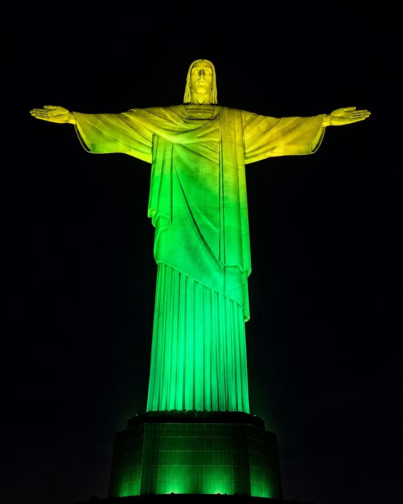
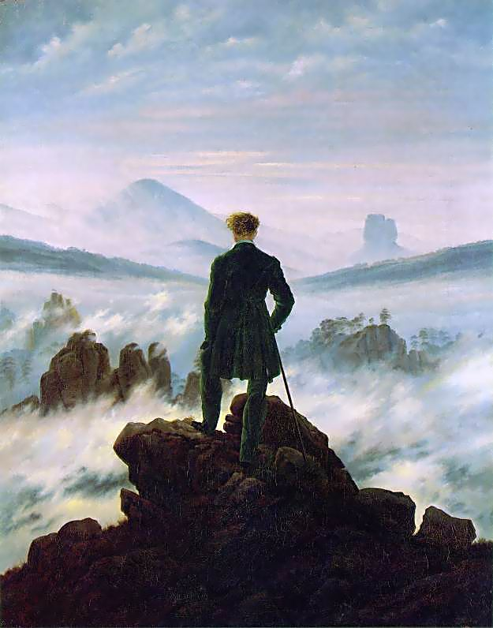

 
<small>*Cristo Redentor statue above Rio de Janeiro, Brazil, posted by Professor Scott Salmon after re-election of Luis Inácio Lula da Silva as president of Brazil, Facebook, Monday 26 October 2026.*</small>

***

 <small>*Caspar David Friedrich, "Aura Farming" (1817-18)*</small>

>[!custom] Walter Benjamin on aura
>The concept of aura which was proposed above with reference to historical objects may usefully be illustrated with reference to the aura of natural ones. We define the aura of the latter as the unique phenomenon of a distance, however close it may be. If, while resting on a summer afternoon, you follow with your eyes a mountain range on the horizon or a branch which casts its shadow over you, you experience the aura of those mountains, of that branch. This image makes it easy to comprehend the social bases of the contemporary decay of the aura. It rests on two circumstances, both of which are related to the increasing significance of the masses in contemporary life. Namely, the desire of contemporary masses to bring things ‘closer’ spatially and humanly, which is just as ardent as their bent toward overcoming the uniqueness of every reality by accepting its reproduction. Every day the urge grows stronger to get hold of an object at very close range by way of its likeness, its reproduction. Unmistakably, reproduction as offered by picture magazines and newsreels differs from the image seen by the unarmed eye. Uniqueness and permanence are as closely linked in the latter as are transitoriness and reproducibility in the former. To pry an object from its shell, to destroy its aura, is the mark of a perception whose ‘sense of the universal equality of things’ has increased to such a degree that it extracts it even from a unique object by means of reproduction. Thus is manifested in the field of perception what in the theoretical sphere is noticeable in the increasing importance of statistics. The adjustment of reality to the masses and of the masses to reality is a process of unlimited scope, as much for thinking as for perception.
>
>-- "The Work of Art in the Age of Mechanical Reproduction" (1935)

>[!custom] Aura farming
>Aura farming, the display of composed, unpredictable movement that reads as effortless charisma, has moved in two years from gaming slang to staged competitions. The trend runs on folk rules of surprising precision: short, unforeseeable moves win; polish is irrelevant; and visible effort voids the verdict, so that farming aura overtly is the one reliable way to lose it. Digital culture research has documented adjacent phenomena but offers no account of what these audiences are actually judging or why the effortlessness clause holds. This paper provides one. Aura, it argues, is a verdict read in the global mode of gestural meaning: a judgment on the integration of a persona with its own movement, made on the display as a whole rather than assembled from its parts. The farming paradox then dissolves as a collision of grains: the accounting grain in which points are tallied cannot capture, and actively corrupts, the global grain in which the verdict is read. The account explains why the trend belongs to the predictive-machinery era, treats NPC streaming as its structural inverse, and yields testable predictions about segmentation, persona congruence, and attributed origin.
>
> -- Luis Escobar L.-Dellamary, "[The Unfarmable Aura: What Aura Farming Displays, and Why Visible Effort Voids It](pdf/aura-farming.pdf)" (*Preprints.org*, 3 September 2026)

***

- Candela Martin, "[‘Farmear aura’: el fenómeno que estalló en Argentina y Brasil estrena su primera batalla en España](https://www.elobservador.com.uy/espana/sucede/farmear-aura-el-fenomeno-que-estallo-argentina-y-brasil-estrena-su-primera-batalla-espana-n6054791)" (*El Observador*, 22 August 2026)
- "[The new face of teenage cool? Latin America’s ‘aura farming’](https://www.thetimes.com/article/d2ce71b7-2cf9-483c-8d91-e2322f45bf16?shareToken=d0f9ad5882bb8ad4a88bca3a8a82a51f)" (*The Times*)
- Mitchell McCluskey, "[‘Aura farming’ began as a meme. Latin American youth have turned it into a competitive sport](https://edition.cnn.com/2026/08/24/americas/aura-battles-latin-america-youth-intl-latam)" (*CNN*, 24 August 2026)
